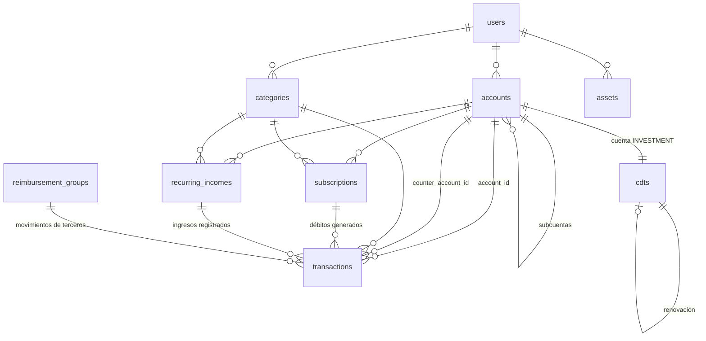

# Base de datos — Módulo de Finanzas (v0)

> Primera estructura de datos para el MVP de finanzas. Funcionalidades en [`modulo-finanzas.md`](./modulo-finanzas.md). Las secciones (§) refieren a ese documento.
>
> Motor: **PostgreSQL** (servidor, SQLAlchemy 2 + Alembic) y **Expo SQLite** (cliente). Ambos comparten el mismo esquema lógico salvo las columnas marcadas como *solo cliente* o *solo servidor*.

## Convenciones

| Concepto | PostgreSQL | SQLite (cliente) |
|---|---|---|
| ID | `UUID` generado en el **cliente** (v4; v5 determinista para débitos de suscripciones) | `TEXT` |
| Dinero | `NUMERIC(14,2)` | `INTEGER` en centavos |
| Fecha/hora | `TIMESTAMPTZ` (UTC) | `TEXT` ISO-8601 UTC |
| Fecha | `DATE` | `TEXT` `YYYY-MM-DD` |
| Booleano | `BOOLEAN` | `INTEGER` 0/1 |
| Enum | `VARCHAR` + `CHECK` | `TEXT` + `CHECK` |

**Multiusuario:** todas las tablas de datos llevan `user_id UUID NOT NULL` (FK → `users.id`). El servidor filtra **siempre** por el `user_id` del JWT; un usuario nunca puede leer ni escribir registros de otro. Las FKs entre tablas deben apuntar a registros del mismo usuario. `user_id` existe **solo en el servidor**:
- El cliente **no** tiene columna `user_id` ni la envía en el PUSH; el servidor la asigna a partir del JWT al insertar.
- En el PULL, el servidor devuelve solo registros del usuario autenticado y omite `user_id` en la respuesta.
- La base local contiene únicamente los datos del usuario autenticado. Al cerrar sesión se **borra la base local** (o se usa un archivo SQLite por usuario), para que otro usuario en el mismo dispositivo nunca vea esos datos.
- Índices del servidor: `user_id` va como primera columna en los índices compuestos de consulta por usuario (los índices de §3 sobre una sola FK, como `counter_account_id`, no lo necesitan).
- **Aislamiento en la base de datos** (spec 003): cada tabla de datos tiene `UNIQUE (user_id, id)` y toda FK entre tablas de datos es **compuesta**: `(user_id, account_id) → accounts(user_id, id)`. Así PostgreSQL rechaza una referencia a un registro de otro usuario aunque falle la lógica de la aplicación. Con `MATCH SIMPLE` (por defecto) una FK con columna nula no se verifica, y usan `NO ACTION` para que el borrado en cascada de un usuario funcione.

**Columnas de sincronización** — presentes en todas las tablas sincronizables (se omiten en las tablas de abajo):

| Columna | Tipo | Dónde | Descripción |
|---|---|---|---|
| `created_at` | TIMESTAMPTZ NOT NULL | ambos | Creación del registro. |
| `updated_at` | TIMESTAMPTZ NOT NULL | ambos | Última modificación (reloj del dispositivo que editó). Se usa para **LWW** en el PUSH. |
| `deleted_at` | TIMESTAMPTZ NULL | ambos | Borrado lógico. |
| `server_updated_at` | TIMESTAMPTZ NOT NULL | servidor (y copia en cliente) | Lo asigna el **servidor** al aceptar un cambio. Es el **cursor del PULL**. Índice (`user_id`, `server_updated_at`). |
| `is_dirty` | INTEGER 0/1 | **solo cliente** | 1 = cambio local pendiente de PUSH. |

**Moneda:** solo COP en el MVP. Se incluye `currency CHAR(3) DEFAULT 'COP'` en `accounts`; las transacciones heredan la moneda de su cuenta.

---

## Diagrama



---

## 1. `accounts` — Cuentas, subcuentas, tarjetas e inversiones (§1, §3, §10)

Autorreferencia `parent_account_id` para subcuentas (cajitas).

| Columna | Tipo | Restricciones | Descripción |
|---|---|---|---|
| `id` | UUID | PK | |
| `user_id` | UUID | FK → users.id, NOT NULL | Dueño del registro. **Solo servidor.** |
| `parent_account_id` | UUID | FK → accounts.id, NULL | Si tiene valor, es subcuenta. Solo **un nivel** de profundidad. |
| `name` | VARCHAR(100) | NOT NULL | "Bancolombia Ahorros", "Nu", "Cajita Viaje". |
| `type` | VARCHAR(20) | NOT NULL, CHECK | `CHECKING`, `SAVINGS`, `CASH`, `CREDIT_CARD`, `POCKET` (cajita), `INVESTMENT`. |
| `nature` | VARCHAR(10) | NOT NULL, CHECK | `ASSET` / `LIABILITY`. `CREDIT_CARD` ⇒ `LIABILITY`. |
| `currency` | CHAR(3) | NOT NULL DEFAULT 'COP' | |
| `icon` / `color` | VARCHAR(50) | NULL | Personalización UI. |
| `opening_balance` | NUMERIC(14,2) | NOT NULL DEFAULT 0 | Saldo inicial al crear la cuenta en la app. |
| `credit_limit` | NUMERIC(14,2) | NULL | Cupo (solo `CREDIT_CARD`). |
| `statement_day` | SMALLINT | NULL, 1–31 | Día de corte (tarjeta). |
| `payment_due_day` | SMALLINT | NULL, 1–31 | Día de pago (tarjeta). |
| `is_excluded_from_net_worth` | BOOLEAN | NOT NULL DEFAULT FALSE | Excluir del patrimonio neto (§7). |
| `is_archived` | BOOLEAN | NOT NULL DEFAULT FALSE | Cuenta cerrada; se oculta pero conserva historia. |
| `sort_order` | INT | NOT NULL DEFAULT 0 | |

**Saldo (derivado, no almacenado):**

```
saldo = opening_balance
      + Σ INCOME
      − Σ EXPENSE
      − Σ TRANSFER donde account_id = cuenta          (sale)
      + Σ TRANSFER donde counter_account_id = cuenta  (entra)
```

Para `LIABILITY` el mismo cálculo da un valor negativo = deuda. Si el rendimiento lo exige, se añadirá una caché local de saldos recalculable, nunca sincronizada.

## 2. `categories` — Categorías de gasto e ingreso (§2, §6, §11)

Categorías con las que el usuario clasifica sus movimientos. Cada usuario tiene las suyas; al registrarse se crea un set inicial (seed) que puede editar. Se crea cada vez que se registra un usuario, en la misma transacción (hoy, con la seed del primer despliegue):

- **Gasto:** Transporte, Alimentación, Entretenimiento, Suscripciones, Servicios, Mercado, Combustible, Parqueadero, Salud, Fitness, Viajes y Ropa.
- **Ingreso:** Salario, Rendimientos y Otros ingresos.

| Columna | Tipo | Restricciones | Descripción |
|---|---|---|---|
| `id` | UUID | PK | |
| `user_id` | UUID | FK → users.id, NOT NULL | Dueño del registro. **Solo servidor.** |
| `name` | VARCHAR(50) | NOT NULL | "Transporte". Único (`user_id`, `name`, `kind`) entre las **no borradas** (índice parcial `WHERE deleted_at IS NULL`): una categoría borrada no bloquea su nombre. |
| `kind` | VARCHAR(10) | NOT NULL, CHECK | `INCOME` / `EXPENSE`. |
| `icon` / `color` | VARCHAR(50) | NULL | Para la UI y el dashboard (§11). |
| `sort_order` | INT | NOT NULL DEFAULT 0 | |

## 3. `transactions` — Movimientos (§2, §3, §4, §5)

Montos **siempre positivos**; la dirección la da `type`. Una transferencia es **una sola fila** con origen (`account_id`) y destino (`counter_account_id`).

| Columna | Tipo | Restricciones | Descripción |
|---|---|---|---|
| `id` | UUID | PK | v5 determinista si viene de una suscripción. |
| `user_id` | UUID | FK → users.id, NOT NULL | Dueño del registro. **Solo servidor.** |
| `account_id` | UUID | FK → accounts.id, NOT NULL | Cuenta afectada (origen en transferencias). |
| `counter_account_id` | UUID | FK → accounts.id, NULL | Destino; **obligatorio si y solo si** `type = TRANSFER`. |
| `type` | VARCHAR(10) | NOT NULL, CHECK | `INCOME`, `EXPENSE`, `TRANSFER`. |
| `amount` | NUMERIC(14,2) | NOT NULL, CHECK > 0 | |
| `category_id` | UUID | FK → categories.id, NULL | NULL en transferencias o pendiente de clasificar. |
| `category_source` | VARCHAR(10) | NOT NULL DEFAULT 'MANUAL' | `MANUAL` / `AI`. Si el usuario corrige ⇒ `MANUAL` (§6). |
| `occurred_at` | TIMESTAMPTZ | NOT NULL | Fecha del movimiento. |
| `description` | TEXT | NULL | |
| `reimbursement_group_id` | UUID | FK → reimbursement_groups.id, NULL | Si tiene valor, el movimiento es **dinero de terceros** (viático, adelanto o reembolso) (§5). |
| `subscription_id` | UUID | FK → subscriptions.id, NULL | Débito generado por suscripción. |
| `subscription_period` | VARCHAR(7) | NULL | `YYYY-MM` (o `YYYY` en anuales). UNIQUE (`subscription_id`, `subscription_period`). |
| `recurring_income_id` | UUID | FK → recurring_incomes.id, NULL | Ingreso registrado desde un ingreso recurrente; solo con `type = INCOME`. |
| `recurring_income_period` | VARCHAR(7) | NULL | `YYYY-MM` (o `YYYY` en anuales). Obligatorio si y solo si hay `recurring_income_id`. **Sin UNIQUE**: se permite más de un ingreso por periodo. |
| `cdt_id` | UUID | FK → cdts.id, NULL | Movimiento ligado a un CDT (apertura, interés, retención, pago). |

**Índices:** (`user_id`, `account_id`, `occurred_at`), (`counter_account_id`), (`user_id`, `category_id`, `occurred_at`), (`reimbursement_group_id`), (`recurring_income_id`, `recurring_income_period`), (`user_id`, `server_updated_at`).

**Reglas derivadas:**
- Pago de tarjeta = `TRANSFER` de cuenta de ahorros → tarjeta (§3).
- Gasto personal (§11) = `EXPENSE` con `reimbursement_group_id IS NULL`.
- Ingreso personal = `INCOME` con `reimbursement_group_id IS NULL`.

## 4. `reimbursement_groups` — Viáticos, adelantos y reembolsos (§5)

El dinero de terceros **vive en tus cuentas normales**: no hay una cuenta aparte. Lo que lo distingue es que sus movimientos se etiquetan con un **grupo** (un viaje, una legalización). Así afectan el saldo real de la cuenta, pero quedan fuera del gasto e ingreso personal.

| Columna | Tipo | Restricciones | Descripción |
|---|---|---|---|
| `id` | UUID | PK | |
| `user_id` | UUID | FK → users.id, NOT NULL | Dueño del registro. **Solo servidor.** |
| `name` | VARCHAR(100) | NOT NULL | "Viaje Medellín – marzo". |
| `payer` | VARCHAR(100) | NULL | Quién paga/reembolsa (empresa, cliente). |
| `kind` | VARCHAR(15) | NOT NULL, CHECK | `REIMBURSEMENT` (pago yo y me devuelven) / `ADVANCE` (me adelantan y gasto de ahí). |
| `status` | VARCHAR(10) | NOT NULL DEFAULT 'OPEN' | `OPEN` (gastando), `SUBMITTED` (legalizado/solicitado), `SETTLED` (saldado). |
| `notes` | TEXT | NULL | |

**Funcionamiento** — todos los movimientos del grupo son `transactions` normales con `reimbursement_group_id`:

| Situación | Movimiento |
|---|---|
| Pago un viático con mi plata | `EXPENSE` en mi cuenta, con el grupo. |
| La empresa me reembolsa | `INCOME` en mi cuenta, con el grupo. |
| La empresa me da un adelanto | `INCOME` en mi cuenta, con el grupo. |
| Gasto del adelanto | `EXPENSE` en mi cuenta, con el grupo. |
| Devuelvo el sobrante del adelanto | `EXPENSE` en mi cuenta, con el grupo. |

**Saldo del grupo** = Σ `INCOME` del grupo − Σ `EXPENSE` del grupo:
- **Negativo** → la empresa me debe (pendiente por reembolsar).
- **Positivo** → tengo dinero de la empresa (sobrante del adelanto por gastar o devolver).
- **Cero** → saldado; se puede marcar `SETTLED`.

**Ejemplos:**
- *Reembolso:* gasto 200.000 en hotel y 50.000 en taxis → saldo −250.000 (me deben). Llega el reembolso de 250.000 → saldo 0 → `SETTLED`.
- *Adelanto:* recibo 500.000 → saldo +500.000. Gasto 420.000 → +80.000 (tengo 80.000 de la empresa). Devuelvo 80.000 → 0 → `SETTLED`. Si hubiera gastado 550.000, el saldo sería −50.000 y la empresa me debería esa diferencia.

## 5. `subscriptions` — Suscripciones (§4)

| Columna | Tipo | Restricciones | Descripción |
|---|---|---|---|
| `id` | UUID | PK | |
| `user_id` | UUID | FK → users.id, NOT NULL | Dueño del registro. **Solo servidor.** |
| `account_id` | UUID | FK → accounts.id, NOT NULL | Cuenta o tarjeta de cobro. |
| `category_id` | UUID | FK → categories.id, NULL | |
| `name` | VARCHAR(100) | NOT NULL | "Netflix". |
| `icon` | VARCHAR(100) | NULL | |
| `amount` | NUMERIC(14,2) | NOT NULL, CHECK > 0 | |
| `billing_cycle` | VARCHAR(10) | NOT NULL DEFAULT 'MONTHLY' | `MONTHLY`, `YEARLY`. |
| `billing_day` | SMALLINT | NOT NULL, 1–31 | Si el mes es más corto, se cobra el último día. |
| `billing_month` | SMALLINT | NULL, 1–12 | Obligatorio en `YEARLY`. |
| `start_date` | DATE | NOT NULL | Primer periodo a cobrar. |
| `status` | VARCHAR(10) | NOT NULL DEFAULT 'ACTIVE' | `ACTIVE`, `PAUSED`, `CANCELLED`. |

`next_billing_date` **no se almacena**: se calcula a partir de `billing_*` y del último periodo generado. Almacenarlo crearía conflictos LWW cuando cliente y servidor generan el mismo débito.

**Generación idempotente:** `transactions.id = uuid5(NAMESPACE, f"{subscription_id}:{period}")` + UNIQUE (`subscription_id`, `subscription_period`). Cliente y servidor pueden generar el mismo débito sin duplicarlo.

## 6. `cdts` — Inversiones CDT (§10)

Cada CDT tiene además una fila en `accounts` (`type = INVESTMENT`) para que su capital entre en saldos y patrimonio con la misma lógica que las demás cuentas. Apertura = `TRANSFER` cuenta origen → cuenta del CDT.

| Columna | Tipo | Restricciones | Descripción |
|---|---|---|---|
| `id` | UUID | PK | |
| `user_id` | UUID | FK → users.id, NOT NULL | Dueño del registro. **Solo servidor.** |
| `account_id` | UUID | FK → accounts.id, NOT NULL, UNIQUE | Cuenta `INVESTMENT` asociada. |
| `issuer` | VARCHAR(100) | NOT NULL | Entidad emisora. |
| `certificate_number` | VARCHAR(50) | NULL | Número de título. |
| `principal` | NUMERIC(14,2) | NOT NULL, CHECK > 0 | Capital. |
| `annual_rate_ea` | NUMERIC(7,4) | NOT NULL | Tasa **efectiva anual** en % (p. ej. `10.2500`). |
| `annual_rate_nominal` | NUMERIC(7,4) | NOT NULL | Tasa **nominal anual** en %, según la periodicidad de `interest_payment` (p. ej. N.M.V. si es mensual). |
| `term_days` | INT | NOT NULL, CHECK > 0 | |
| `opened_on` | DATE | NOT NULL | |
| `matures_on` | DATE | NOT NULL | `opened_on + term_days` (calculado al crear, editable). |
| `interest_payment` | VARCHAR(12) | NOT NULL | `AT_MATURITY`, `MONTHLY`, `QUARTERLY`, `SEMIANNUAL`, `ANNUAL`. |
| `withholding_rate` | NUMERIC(5,2) | NOT NULL DEFAULT 4.00 | % de retención en la fuente sobre rendimientos (configurable). |
| `source_account_id` | UUID | FK → accounts.id, NOT NULL | De dónde salió el capital. |
| `payout_account_id` | UUID | FK → accounts.id, NULL | A dónde llega al vencer. |
| `status` | VARCHAR(10) | NOT NULL DEFAULT 'ACTIVE' | `ACTIVE`, `MATURED`, `RENEWED`, `CANCELLED`. |
| `renewed_from_cdt_id` | UUID | FK → cdts.id, NULL | CDT anterior si es renovación. |

Ambas tasas las ingresa el usuario tal como aparecen en el título; la app puede sugerir una a partir de la otra. Intereses pagados y retenciones se registran como `transactions` con `cdt_id`.

## 7. `assets` — Bienes (§7)

Bienes cuyo valor no proviene de transacciones (vehículos, inmuebles…). Suman a los activos del patrimonio neto.

| Columna | Tipo | Restricciones | Descripción |
|---|---|---|---|
| `id` | UUID | PK | |
| `user_id` | UUID | FK → users.id, NOT NULL | Dueño del registro. **Solo servidor.** |
| `name` | VARCHAR(100) | NOT NULL | "Mazda 3 2020". |
| `value` | NUMERIC(14,2) | NOT NULL, CHECK ≥ 0 | Valor estimado. |
| `valid_until` | DATE | NOT NULL | Hasta cuándo es válido el valor; pasada la fecha, la app pide actualizarlo. |

## 8. `recurring_incomes` — Ingresos recurrentes (spec 002)

Plantillas de ingresos que se repiten (salario, arriendo recibido, honorarios). A diferencia de `subscriptions`, **no generan movimientos automáticamente**: el usuario registra cada ingreso desde la plantilla y puede cambiar el valor. El valor real queda en `transactions.amount`; `expected_amount` solo prellena el formulario.

| Columna | Tipo | Restricciones | Descripción |
|---|---|---|---|
| `id` | UUID | PK | |
| `user_id` | UUID | FK → users.id, NOT NULL | Dueño del registro. **Solo servidor.** |
| `account_id` | UUID | FK → accounts.id, NOT NULL | Cuenta de destino sugerida. |
| `category_id` | UUID | FK → categories.id, NULL | Categoría con `kind = INCOME`. |
| `name` | VARCHAR(100) | NOT NULL | "Salario". |
| `icon` | VARCHAR(100) | NULL | |
| `expected_amount` | NUMERIC(14,2) | NOT NULL, CHECK > 0 | Valor sugerido, en la moneda de la cuenta; cambiarlo no altera ingresos ya registrados. |
| `cycle` | VARCHAR(10) | NOT NULL DEFAULT 'MONTHLY' | `MONTHLY`, `YEARLY`. |
| `expected_day` | SMALLINT | NOT NULL, 1–31 | Si el mes es más corto, el último día. |
| `expected_month` | SMALLINT | NULL, 1–12 | Obligatorio en `YEARLY`. |
| `start_date` | DATE | NOT NULL | Primer periodo. |
| `status` | VARCHAR(10) | NOT NULL DEFAULT 'ACTIVE' | `ACTIVE`, `PAUSED`. Solo los activos aparecen en el selector del formulario. |

**Borrado:** lógico (`deleted_at`). Los ingresos registrados conservan su `recurring_income_id` para el historial y siguen contando como ingresos normales.

**Aviso de duplicado:** al registrar, si ya existe un `transactions` no borrado con el mismo (`recurring_income_id`, `recurring_income_period`), la app avisa sin bloquear.

## 9. Tablas no sincronizadas

**`sync_metadata`** — *solo cliente*

| Columna | Tipo | Restricciones | Descripción |
|---|---|---|---|
| `table_name` | TEXT | PK | `accounts`, `transactions`… |
| `last_pulled_server_at` | TEXT (TIMESTAMPTZ) | NULL | Máximo `server_updated_at` recibido en el último PULL exitoso. NULL = nunca sincronizada (sync completo). |
| `last_synced_at` | TEXT (TIMESTAMPTZ) | NULL | Hora local del último sync exitoso (solo informativo/UI). |

**`users`** — *solo servidor* (autenticación JWT)

| Columna | Tipo | Restricciones |
|---|---|---|
| `id` | UUID | PK |
| `email` | VARCHAR(255) | NOT NULL, UNIQUE |
| `password_hash` | VARCHAR(255) | NOT NULL |
| `display_name` | VARCHAR(100) | NULL |
| `created_at` | TIMESTAMPTZ | NOT NULL |
| `updated_at` | TIMESTAMPTZ | NOT NULL. Cambia al restablecer la contraseña. |

No hay registro público: el primer usuario lo crea la seed del primer despliegue a partir de variables de entorno.

**`refresh_tokens`** — *solo servidor*

| Columna | Tipo | Restricciones |
|---|---|---|
| `id` | UUID | PK |
| `user_id` | UUID | NOT NULL, FK → users.id ON DELETE CASCADE |
| `session_id` | UUID | NOT NULL. Sesión de un dispositivo: la crea el login y la heredan los tokens sucesores. |
| `token_hash` | CHAR(64) | NOT NULL, UNIQUE. SHA-256 del token opaco. |
| `expires_at` | TIMESTAMPTZ | NOT NULL. Emisión + 7 días. |
| `revoked_at` | TIMESTAMPTZ | NULL |
| `replaced_by_id` | UUID | NULL, FK → refresh_tokens.id. Sucesor en la rotación. |
| `created_at` | TIMESTAMPTZ | NOT NULL |

Un usuario puede tener varias sesiones activas a la vez (una por dispositivo, sin límite). Cada renovación rota el token dentro de su sesión; reutilizar un token ya rotado revoca **solo esa sesión**. Restablecer la contraseña revoca todas.

**`password_reset_codes`** — *solo servidor*: código de recuperación de 6 dígitos y, una vez validado, el permiso para cambiar la contraseña.

| Columna | Tipo | Restricciones |
|---|---|---|
| `id` | UUID | PK |
| `user_id` | UUID | NOT NULL, FK → users.id ON DELETE CASCADE |
| `code_hash` | CHAR(64) | NOT NULL. HMAC-SHA256 con *pepper* de `user_id:código`. |
| `expires_at` | TIMESTAMPTZ | NOT NULL. Creación + 30 min. |
| `failed_attempts` | SMALLINT | NOT NULL DEFAULT 0, 0–5. Al 5.º fallo el código se invalida. |
| `used_at` / `invalidated_at` | TIMESTAMPTZ | NULL |
| `grant_hash` | CHAR(64) | NULL, UNIQUE. SHA-256 del permiso de cambio. |
| `grant_expires_at` / `grant_used_at` | TIMESTAMPTZ | NULL. El permiso dura 10 min. |
| `created_at` | TIMESTAMPTZ | NOT NULL. Cuenta el límite de 3 solicitudes por hora. |

**`login_attempts`** — *solo servidor*: fallos de inicio de sesión para el bloqueo por correo + IP (5 fallos en 15 min bloquean 15 min). `id` BIGINT identity, `email` VARCHAR(255), `ip` INET, `attempted_at` TIMESTAMPTZ. Índice (`email`, `ip`, `attempted_at`). No es dato del usuario: el correo puede no existir.
