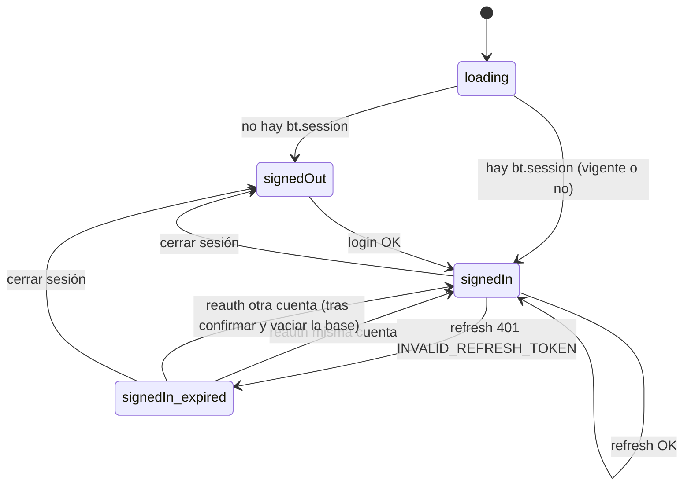

# Data Model: base local del cliente, sesión y estado de sync

**Feature**: [spec.md](./spec.md) · **Research**: [research.md](./research.md)

Fuente del esquema lógico: [`docs/db-finanzas.md`](../../docs/db-finanzas.md). Formato de los registros en la API: [`specs/004-data-sync/data-model.md`](../004-data-sync/data-model.md) §2.

---

## 1. Convenciones de la base local (SQLite)

- Nombres de tablas y columnas en `snake_case`, idénticos a `docs/db-finanzas.md`. **Sin `user_id`** (Principio III).
- `id TEXT PRIMARY KEY` (UUID generado en el cliente).
- Montos: `INTEGER` en **centavos** (`Cents`). Tasas (`annual_rate_ea`, `annual_rate_nominal`, `withholding_rate`): `TEXT` decimal exacto. Nunca `REAL`.
- Fechas-hora: `TEXT` ISO-8601 UTC con `Z` (`2026-10-20T14:00:00.000Z`). Fechas: `TEXT` `YYYY-MM-DD`.
- Booleanos: `INTEGER` 0/1.
- **Sin `FOREIGN KEY` locales**: el servidor es la autoridad de la integridad referencial (spec 004). Un PULL paginado puede traer un registro antes que otro que referencia, y un rechazo puede dejar referencias colgantes temporales. Las validaciones de las pantallas siguen comprobando referencias al crear o editar.
- `PRAGMA user_version` guarda la versión del esquema; las migraciones son una lista ordenada de scripts que se aplican al abrir la base (FR-010).

### Columnas de sincronización (las ocho tablas)

| Columna | Tipo | Notas |
|---|---|---|
| `id` | TEXT PK | UUID del cliente. |
| `created_at` | TEXT NOT NULL | UTC. |
| `updated_at` | TEXT NOT NULL | UTC, reloj del dispositivo que editó. Se usa para LWW y para el ack del PUSH. |
| `deleted_at` | TEXT NULL | Borrado lógico. |
| `server_updated_at` | TEXT NULL | Marca del servidor recibida en el último PULL. `NULL` = nunca bajado (no se sabe si existe en el servidor). Solo informativa: el cursor es opaco y vive en `sync_metadata`. |
| `is_dirty` | INTEGER NOT NULL DEFAULT 0 | 1 = cambio local pendiente de PUSH. |

Índice parcial en cada tabla: `CREATE INDEX idx_<t>_dirty ON <t>(id) WHERE is_dirty = 1`.

---

## 2. Tablas de finanzas

Columnas de datos (además de las de sync). El campo del modelo TypeScript (`domain/types.ts`) y el JSON de la API usan el mismo nombre en camelCase.

| Tabla | Columnas | Tipo especial |
|---|---|---|
| `categories` | `name`, `kind`, `icon`, `color`, `sort_order` | — |
| `reimbursement_groups` | `name`, `payer`, `kind`, `status`, `notes` | — |
| `assets` | `name`, `value`, `valid_until` | `value` money; `valid_until` date |
| `accounts` | `parent_account_id`, `name`, `type`, `nature`, `currency`, `icon`, `color`, `opening_balance`, `credit_limit`, `statement_day`, `payment_due_day`, `is_excluded_from_net_worth`, `is_archived`, `sort_order` | `opening_balance`, `credit_limit` money; 2 bool |
| `subscriptions` | `account_id`, `category_id`, `name`, `icon`, `amount`, `billing_cycle`, `billing_day`, `billing_month`, `start_date`, `status` | `amount` money; `start_date` date |
| `recurring_incomes` | `account_id`, `category_id`, `name`, `icon`, `expected_amount`, `cycle`, `expected_day`, `expected_month`, `start_date`, `status` | `expected_amount` money; `start_date` date |
| `cdts` | `account_id`, `issuer`, `certificate_number`, `principal`, `annual_rate_ea`, `annual_rate_nominal`, `term_days`, `opened_on`, `matures_on`, `interest_payment`, `withholding_rate`, `source_account_id`, `payout_account_id`, `status`, `renewed_from_cdt_id` | `principal` money; 3 rate; 2 date |
| `transactions` | `account_id`, `counter_account_id`, `type`, `amount`, `category_id`, `category_source`, `occurred_at`, `description`, `reimbursement_group_id`, `subscription_id`, `subscription_period`, `recurring_income_id`, `recurring_income_period`, `cdt_id` | `amount` money; `occurred_at` datetime |

Índices de lectura: no hacen falta para las pantallas (leen el espejo en memoria, research R2). Solo los de `is_dirty` y el PK.

Las reglas de validación de cada entidad son las ya implementadas en `domain/schemas/*` y en los repositorios (spec 001/002); esta feature no las cambia.

---

## 3. Mapa de dependencias

Se usa para ordenar el PUSH (research R8) y para calcular dependientes al descartar un registro nuevo (research R10).

| Tabla | Referencias (columna → tabla) | Orden |
|---|---|---|
| `categories` | — | 1 |
| `reimbursement_groups` | — | 2 |
| `assets` | — | 3 |
| `accounts` | `parent_account_id` → `accounts` | 4 (padres antes que subcuentas) |
| `subscriptions` | `account_id` → `accounts`, `category_id` → `categories` | 5 |
| `recurring_incomes` | `account_id` → `accounts`, `category_id` → `categories` | 6 |
| `cdts` | `account_id`, `source_account_id`, `payout_account_id` → `accounts`; `renewed_from_cdt_id` → `cdts` | 7 (anteriores antes que renovaciones) |
| `transactions` | `account_id`, `counter_account_id` → `accounts`; `category_id` → `categories`; `reimbursement_group_id` → `reimbursement_groups`; `subscription_id` → `subscriptions`; `recurring_income_id` → `recurring_incomes`; `cdt_id` → `cdts` | 8 |

---

## 4. Tablas de control (solo cliente)

### `sync_metadata`

| Columna | Tipo | Notas |
|---|---|---|
| `table_name` | TEXT PK | Una de las ocho tablas. Se insertan las ocho al crear el esquema. |
| `pull_cursor` | TEXT NULL | Cursor opaco del servidor. `NULL` = próximo PULL trae la tabla completa (primer sync, o forzado por R9/R10/`INVALID_CURSOR`). |
| `last_synced_at` | TEXT NULL | Hora local (UTC) en que la tabla completó un PULL. Solo informativa. `NULL` en las ocho = el primer sync no ha terminado. |

### `sync_rejections`

| Columna | Tipo | Notas |
|---|---|---|
| `table_name` | TEXT | PK compuesta con `record_id`. |
| `record_id` | TEXT | |
| `code` | TEXT NOT NULL | `VALIDATION_ERROR`, `INVALID_REFERENCE`, `DEPENDENCY_REJECTED`, `INCOHERENT`, `DUPLICATE`, `ID_CONFLICT`, `CLOCK_AHEAD`, o `LOCAL_PARSE_ERROR` (registro del PULL que no se pudo convertir). |
| `message` | TEXT NOT NULL | Mensaje del servidor (español). |
| `sent_updated_at` | TEXT NULL | `updated_at` de la versión rechazada. |
| `rejected_at` | TEXT NOT NULL | UTC. |

**Ciclo de vida**: se crea o reemplaza con cada `REJECTED`. Se borra cuando el registro recibe `APPLIED`/`DISCARDED`, cuando un PULL lo sobrescribe con una versión más nueva del servidor, o cuando el usuario descarta su cambio (FR-015a).

---

## 5. Sesión (almacenamiento seguro, fuera de SQLite)

### `bt.session`

```ts
interface StoredSession {
  accessToken: string;
  accessExpiresAt: string;   // UTC = recibido + expiresIn
  refreshToken: string;
  refreshExpiresAt: string;  // UTC = recibido + refreshExpiresIn (informativo)
}
```

### `bt.profile`

```ts
interface StoredProfile {
  id: string;           // usuario dueño de los datos locales (research R12)
  email: string;
  displayName: string | null;
}
```

Android: `expo-secure-store`. Web: `localStorage` (research R5). Ambas claves se borran al cerrar sesión.

---

## 6. Estados en memoria (zustand)

### Sesión (`useSessionStore`)

```
status: 'loading' | 'signedOut' | 'signedIn'
expired: boolean      // signedIn con renovación inválida (FR-031)
profile: StoredProfile | null
```



La guarda de rutas usa `status === 'signedIn'` (vigente o vencida).

### Sync (`useSyncStore`)

```
phase: 'idle' | 'pushing' | 'pulling'
connectivity: 'online' | 'offline'
lastSyncedAt: string | null      // máx. de sync_metadata.last_synced_at
initialSyncComplete: boolean     // las 8 tablas con last_synced_at
pendingCount: number             // Σ is_dirty = 1
rejections: SyncRejection[]
lastError: { kind: 'network' | 'server' | 'session'; message: string } | null
clockAhead: boolean              // hay rechazos CLOCK_AHEAD
```

Estado mostrado en Ajustes (FR-023), derivado: `sincronizando` (phase ≠ idle) › `sesión vencida` (session.expired) › `sin conexión` › `con errores` (rejections > 0 o lastError) › `sincronizado`.

### Espejo de datos (`useFinanceStore`, existente)

Mismo tipo `FinanceData` que hoy, sin `seedMode`. Se hidrata desde SQLite y solo se modifica después de confirmar cada transacción (research R2).
